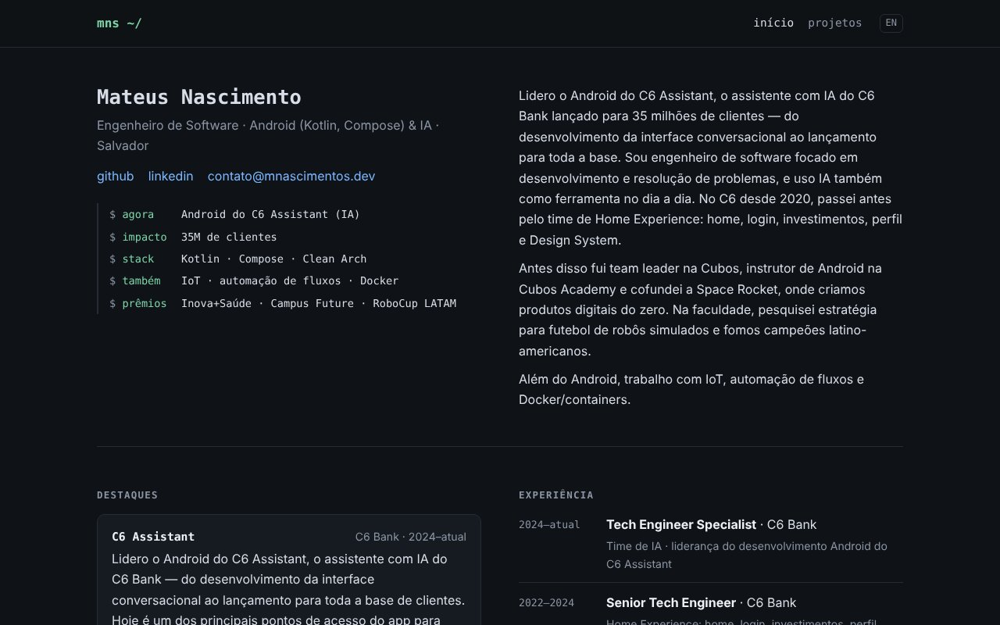

# mnascimentos.dev

My personal site: projects, experience and résumé.

**[mnascimentos.github.io/mnascimentos.dev](https://mnascimentos.github.io/mnascimentos.dev/)**



## About me

I'm Mateus Nascimento, a software engineer from Salvador, Brazil. I lead Android development of C6 Bank's AI assistant (C6 Assistant). Before that I worked on the bank's Home Experience team, built apps at Cubos and Space Rocket, and did robotics research at UNEB.

[LinkedIn](https://www.linkedin.com/in/mateusn/) · [contato@mnascimentos.dev](mailto:contato@mnascimentos.dev)

## The code

Plain HTML and CSS generated by a small Node script (`src/build.mjs`), no dependencies. Content lives in `content/site.json` (PT) and `content/site.en.json` (EN). Every push to `main` is deployed to GitHub Pages by GitHub Actions.

```bash
npm run dev     # http://localhost:4321
npm run build   # outputs to dist/
```

How to edit and publish: [docs/GUIDE.md](docs/GUIDE.md) (in Portuguese).
